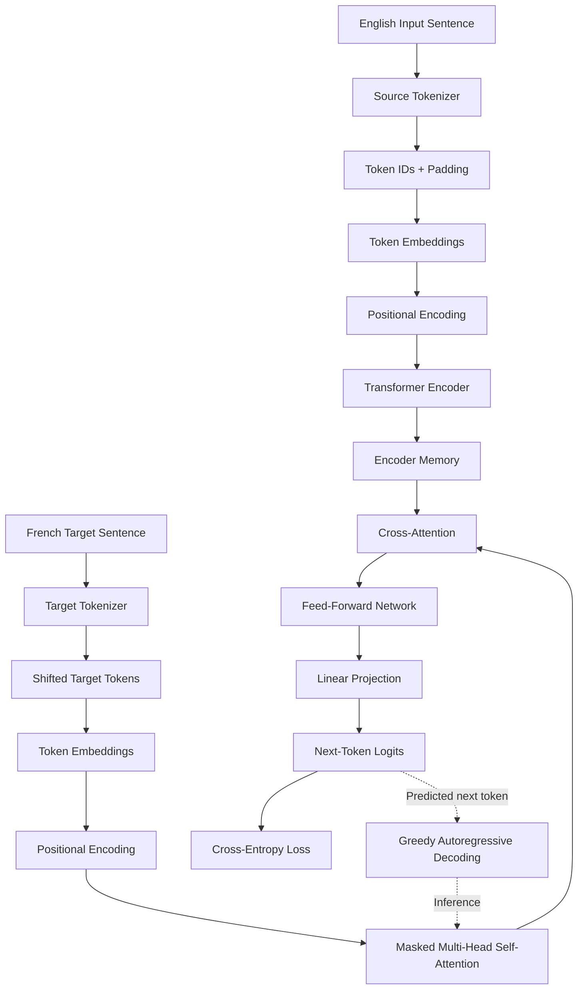

# Transformer from Scratch with PyTorch

A Transformer-based neural machine translation model built from scratch using PyTorch. This project explores the internal mechanics of encoder-decoder Transformers, including self-attention, positional encoding, masking, teacher forcing, and autoregressive decoding.

## Architecture



## Key Features

- Custom encoder-decoder Transformer architecture.
- Sinusoidal positional encoding.
- Multi-head scaled dot-product attention.
- Causal masking to prevent access to future target tokens.
- Padding masks to ignore padded tokens during attention and loss calculation.
- Teacher forcing during training.
- Greedy autoregressive decoding for inference.
- AdamW optimization, gradient clipping, and early stopping.
- Best-validation-loss checkpointing.
- GPU acceleration when CUDA is available.

## Tech Stack

- Python
- PyTorch
- Hugging Face Datasets
- Custom word-level tokenizers
- Matplotlib or other tools for optional training visualizations

## Dataset

The project uses the English-French configuration of the Hugging Face dataset:

[`Helsinki-NLP/opus_books`](https://huggingface.co/datasets/Helsinki-NLP/opus_books)

The training script creates training and validation splits. Dataset limits are configurable to support experiments with different training sizes.

## Project Structure

```text
transformer-translation/
├── src/
│   ├── config.py
│   ├── positional_encoding.py
│   ├── attention.py
│   ├── feed_forward.py
│   ├── encoder.py
│   ├── decoder.py
│   ├── transformer.py
│   ├── data.py
│   ├── tokenizer.py
│   ├── translation_dataset.py
│   ├── collate.py
│   ├── train.py
│   └── translate.py
├── checkpoints/
│   └── best_transformer.pt
├── requirements.txt
└── README.md
```

*The structure above represents the intended project layout; adjust filenames and checkpoint locations to match your repository.*

## Installation

Clone the repository and enter its directory:

```bash
git clone https://github.com/maroofiums/Transformer-from-Scratch.git
cd transformer-translation
```

Install dependencies:

```bash
pip install torch datasets
```

Ensure that the `src` directory is importable as a Python package. If required, add an empty `src/__init__.py` file.

## Training

Run the training module from the project root:

```bash
python -m src.train
```

The training script configures the dataset, tokenizers, model, optimizer, attention masks, and validation loop. It saves the checkpoint with the best validation loss and stops early when validation performance no longer improves sufficiently.

Review the configuration in `src/train.py` before training, especially:

- Training and validation dataset limits
- Batch size
- Maximum sequence length
- Number of epochs and patience
- Learning rate and weight decay
- Transformer dimensions and dropout

## Translation

After training, run:

```bash
python -m src.translate
```

Check that the inference script loads the same checkpoint path and reconstructs the model with the saved configuration and tokenizer vocabularies.

## How the Transformer Works

1. **Tokenization:** Sentences are converted into token IDs, including special tokens such as padding, beginning-of-sequence, unknown, and end-of-sequence tokens.
2. **Embedding:** Each token ID is mapped to a dense vector.
3. **Positional encoding:** Position information is added to token embeddings.
4. **Encoder:** Self-attention allows source tokens to incorporate contextual information from other source tokens.
5. **Decoder:** Masked self-attention processes previously available target tokens. Cross-attention uses the encoder output to condition predictions on the English input.
6. **Training:** The model predicts the next French token using shifted target sequences. Cross-entropy loss ignores padding tokens.
7. **Inference:** Greedy decoding repeatedly selects the most probable next token until an end-of-sequence token or the maximum sequence length is reached.

## Current Limitations

- The word-level tokenizer can struggle with rare words, names, and unseen vocabulary.
- Small training subsets and limited model capacity can reduce translation quality.
- Training for too long can cause overfitting, so validation loss and checkpoint selection matter.
- Greedy decoding may produce repetitive or grammatically incorrect translations.
- A saved checkpoint is not evidence of good translation quality by itself; evaluate the model on held-out examples.

## Future Improvements

- Replace word-level tokenization with BPE or SentencePiece.
- Add BLEU or chrF evaluation on a held-out test set.
- Compare greedy decoding with beam search.
- Plot training and validation loss.
- Perform controlled experiments with model dimensions, dropout, and dataset size.
- Compare the custom implementation with a pretrained translation baseline.

## Learning Objectives

This project is intended as a practical study of Transformer internals rather than a claim of state-of-the-art translation performance. It provides hands-on experience with attention, masking, sequence modeling, training loops, and inference.

## License

Choose and add an appropriate open-source license before distributing the project.
