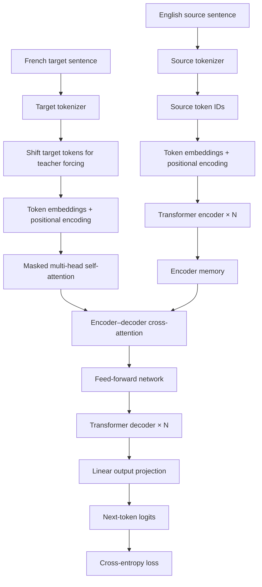
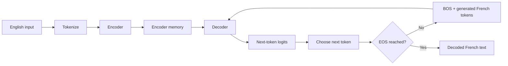

# Transformer from Scratch

An educational **encoder–decoder Transformer built with PyTorch** for English-to-French neural machine translation. The goal is to understand the core components of the Transformer architecture by implementing them as separate modules rather than relying on a prebuilt `nn.Transformer`.

> **Project status:** Learning project / work in progress. Translation quality and end-to-end execution should be validated before treating this as a production-ready translation system.

## Architecture

The model follows the encoder–decoder design introduced in *Attention Is All You Need*.



### Inference flow



## Core concepts implemented

- **Scaled dot-product attention** — computes attention weights from queries, keys, and values.
- **Multi-head attention** — lets the model attend to different representation subspaces.
- **Sinusoidal positional encoding** — adds sequence-position information to token embeddings.
- **Encoder and decoder blocks** — combine attention, feed-forward layers, residual connections, and layer normalization.
- **Causal masking** — prevents decoder positions from attending to future target tokens.
- **Padding masks** — prevent padded tokens from being used as attention keys.
- **Teacher forcing** — feeds the correct previous target tokens to the decoder during training.
- **Validation and checkpointing** — tracks validation loss and saves a best checkpoint in the training pipeline.

## Dataset

This project uses the English–French configuration of the Hugging Face dataset [`Helsinki-NLP/opus_books`](https://huggingface.co/datasets/Helsinki-NLP/opus_books).

The code uses separate custom word-level tokenizers for English and French. Word-level tokenization is simple to understand, but rare and unseen words may map to the unknown-token symbol.

## Project structure

```text
Transformer-from-Scratch/
└── src/
    ├── config.py
    ├── positional_encoding.py
    ├── attention.py
    ├── feed_forward.py
    ├── encoder.py
    ├── decoder.py
    ├── transformer.py
    ├── data.py
    ├── tokenizer.py
    ├── translation_dataset.py
    ├── collate.py
    ├── train.py
    └── translate.py
```

## Setup

Clone the repository:

```bash
git clone https://github.com/maroofiums/Transformer-from-Scratch.git
cd Transformer-from-Scratch
```

Install the main dependencies:

```bash
python -m pip install torch datasets
```

Use a Python environment compatible with your installed PyTorch build. For GPU training, install the PyTorch build that matches your CUDA setup; CPU training is also possible.

## Training

From the repository root, run:

```bash
python -m src.train
```

The training script loads the dataset, builds tokenizers, creates the model and data loaders, and runs training and validation. Check `src/train.py` to adjust the dataset limits, batch size, maximum sequence length, model configuration, learning rate, and early-stopping settings.

A successful run should produce a checkpoint at the path configured by the training script, typically:

```text
checkpoints/best_transformer.pt
```

## Translation

The inference entry point is:

```bash
python -m src.translate
```

The translation script expects a compatible trained checkpoint. Because the model and inference interfaces are still being developed, verify that the encoder/decoder method names and checkpoint configuration agree between `src/transformer.py` and `src/translate.py` before relying on the generated translations.

## Training objective

For each target sentence, training uses shifted decoder inputs and labels:

- **Decoder input:** `<BOS> Je suis ...`
- **Expected labels:** `Je suis ... <EOS>`

The model produces a vocabulary-sized logit vector at each target position. Cross-entropy loss compares those logits with the expected next token, while padding labels are ignored.

## Limitations

- The custom word-level tokenizer handles rare words less effectively than subword tokenizers such as BPE or SentencePiece.
- Translation quality depends on the amount and diversity of training data, model capacity, and training duration.
- A low training loss does not guarantee good translation quality; validation metrics and held-out examples are important.
- Greedy decoding can produce repetitive or grammatically incorrect text.
- The project is intended for learning and experimentation, not production translation.

## Roadmap

- [ ] Validate a complete training-to-inference run.
- [ ] Add held-out translation examples and BLEU/chrF evaluation.
- [ ] Plot training and validation loss.
- [ ] Compare greedy decoding with beam search.
- [ ] Experiment with BPE or SentencePiece tokenization.
- [ ] Document reproducible settings and measured results.

## Learning objective

The purpose of this repository is to make the internal mechanics of encoder–decoder Transformers easier to study: attention, masks, positional information, teacher forcing, optimization, and autoregressive generation.

## Reference

Vaswani et al., [*Attention Is All You Need*](https://arxiv.org/abs/1706.03762).
